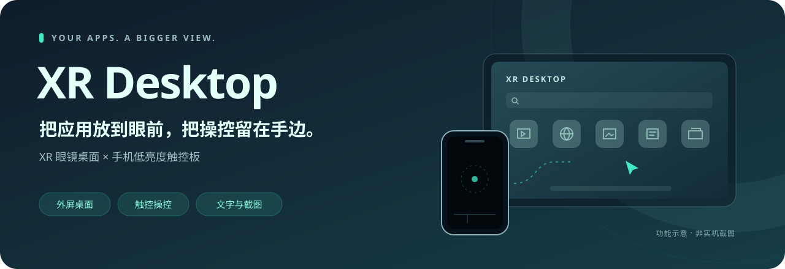

<p align="center">
  
</p>

<p align="center">
  <strong>给 XR 眼镜一个桌面，让手机成为触控板。</strong><br>
  外屏启动应用、切换任务、输入文字、随手截图。
</p>

<p align="center">
  <strong>v0.4.7</strong> · Android 10+ · 简体中文 / English<br>
  重点适配一加 13 / ColorOS 与支持 DP 视频输出的 XR 眼镜连接方案
</p>

<p align="center">
  <a href="https://github.com/Zhuym07/XRGlassesLauncher/releases/latest"><strong>下载 APK</strong></a> ·
  <a href="#快速开始">快速开始</a> ·
  <a href="#触控手势">触控手势</a> ·
  <a href="docs/releases/0.4.7.md">更新说明</a> ·
  <a href="https://github.com/Zhuym07/XRGlassesLauncher/issues">问题反馈</a>
</p>

---

## 一个桌面，两块屏幕

| 外屏负责展示 | 手机负责操控 |
| --- | --- |
| **独立桌面** · 浏览应用、搜索、长按收藏 | **低亮度触控板** · 移动、点击、双击、拖拽与双指滚动 |
| **快捷切换** · 从最近 / 收藏 / 全部应用中选择 | **文字输入** · 将手机输入的文字发送到外屏已聚焦的输入框 |
| **桌面偏好** · 图标大小、应用排序、重连选项 | **外屏截图** · 主页按钮或四指轻点，保存到手机相册 |

> **适配说明**：需要手机支持有线 DP 视频输出。应用与系统的外屏支持情况会影响实际体验，目前不保证所有设备和应用兼容。移动、点击、滚动、文字输入和截图无需 Root；**外屏返回目前需要 Root**，尚未实现 Shizuku。截图需要 Android 11+ 和系统支持。

## 快速开始

1. 从 [Releases](https://github.com/Zhuym07/XRGlassesLauncher/releases/latest) 下载签名 APK，安装到手机并连接 XR 眼镜。
2. 在系统无障碍设置中启用 **XR Desktop**，日常使用保持开启即可。
3. 在应用「设置」中允许悬浮窗，以便在外屏应用上方打开菜单；系统不支持时会使用外屏菜单页面。
4. 在主页点击 **打开外屏桌面**，选择应用，再点击 **进入触控板**。

**从旧 Debug 版升级**：Debug 与 Release 签名不同，无法直接覆盖安装。卸载会清空设置、收藏和草稿，请先保留需要的数据；后续同签名 Release 可正常升级。

## 触控手势

触控板默认全黑、低亮度，主体区域都可以操作。

| 手势 / 位置 | 操作 |
| --- | --- |
| 单指移动 | 移动外屏光标 |
| 轻点 / 连续轻点 | 点击 / 双击 |
| 长按后移动 | 拖拽 |
| 双指滑动 | 水平或垂直滚动 |
| 四指同时轻点 | 截取外屏，可在设置中关闭 |
| 底部控制条左侧 1/3：轻点 | 打开外屏最近应用菜单 |
| 底部控制条右侧 2/3：轻点 | 外屏返回，需要 Root |
| 左上角隐藏区域：轻点 | 退出触控板，回到手机主页 |
| 手机系统返回键 | 退出触控板 |

底部控制条只响应短按，滑动、长按和多指触摸不会触发。沉浸模式下可先从屏幕边缘呼出系统导航，再使用手机返回键。手机音量键不被占用。

> 全黑界面仍保持屏幕点亮以接收触摸，不是物理息屏。退出触控板后会恢复原窗口亮度。

## 文字、截图与应用恢复

**输入文字**：先点击外屏中可编辑的输入框，再从手机主页打开「输入文字」并发送。目标输入框不支持时会提示失败，并保留草稿。

**截取外屏**：点击主页「截取外屏」，或在触控板主体区域四指轻点。图片保存到 `Pictures/XRDesktop`，不需要相册读取权限。安全窗口、禁止截图的应用或系统限制可能导致失败。

**继续上次应用**：尝试在外屏重新打开上次应用。历史记录不代表应用仍在运行，也不保证恢复未保存内容。

**连接与重连**：眼镜断开时会停止输入、关闭临时菜单并回到手机主页；重连后重新发现外屏。「外屏空闲时打开桌面」仅在确认空闲时打开桌面；「重连后打开上次应用」默认关闭，开启后会尝试恢复，已有外屏应用时则保留。

<details>
<summary><strong>更多设置与记录管理</strong></summary>

设置页提供收藏管理、图标大小、应用排序、指针与滚动灵敏度、四指截图、桌面启动与重连选项。支持 **简体中文 / English / 跟随系统**。

「清除最近记录」不会关闭应用或删除上次应用记录。「恢复默认设置」会清除收藏和最近记录，但保留上次应用、语言选择和文字草稿。详细状态可在「诊断」查看。

</details>

## 权限与本地数据

| 权限 / 能力 | 用途 |
| --- | --- |
| 无障碍服务 | 查询外屏窗口、显示光标、发送触摸手势、向聚焦输入框发送文字，以及截取外屏 |
| 悬浮窗 | 在外屏当前应用上方显示快捷菜单 |
| 保持唤醒 | 触控板工作时持续接收手机触摸 |
| Root（可选） | 向指定外屏发送返回操作 |

当前版本未声明网络权限。设置、收藏、应用历史与文字草稿保存在手机本地；截图保存在手机相册。文字仅在点击发送后写入目标输入框。应用禁用了 Android 系统备份，卸载前请自行保留需要的数据。

## 已知限制与反馈

- 光标为无障碍覆盖层，点击和滚动使用触摸手势；不支持系统原生鼠标的悬停、右键或滚轮事件。
- ColorOS 可能在外屏断开时销毁第三方应用任务，本应用只能保留历史并尝试重新打开，无法保证保活。
- 相机等锁定方向或不可调整大小的应用可能出现黑边或比例异常。
- 系统可能拒绝外屏任务、悬浮窗或截图；可先检查权限，再在「诊断」查看原因。

遇到问题可提交 [Issue](https://github.com/Zhuym07/XRGlassesLauncher/issues)，附上手机型号、系统版本、眼镜型号、应用版本和复现步骤。分享诊断信息或截图前，请遮盖个人内容。

## 从源码构建

使用 Android Studio 打开项目并完成 Gradle Sync。需要 **Android SDK 36、JDK 21**；最低运行版本为 **Android 10（API 29）**。

```powershell
.\gradlew.bat :app:assembleDebug :app:testDebugUnitTest :app:lintDebug
```

依赖已缓存时可加 `--offline`。Debug APK 位于 `app/build/outputs/apk/debug/app-debug.apk`。

Release 签名、附件与验证流程见 [发布指南](docs/RELEASING.md)。自动化验证记录和待完成的真机验收见 [0.4.7 发布说明](docs/releases/0.4.7.md)。签名密钥、密码和本机配置仅保留在构建机。

## 版权

© 2026 Ckar。源码公开不等于授予开源许可；本仓库目前未提供源码许可授权。第三方组件的版权与许可见应用「关于与版权」，其许可仅适用于对应组件。
